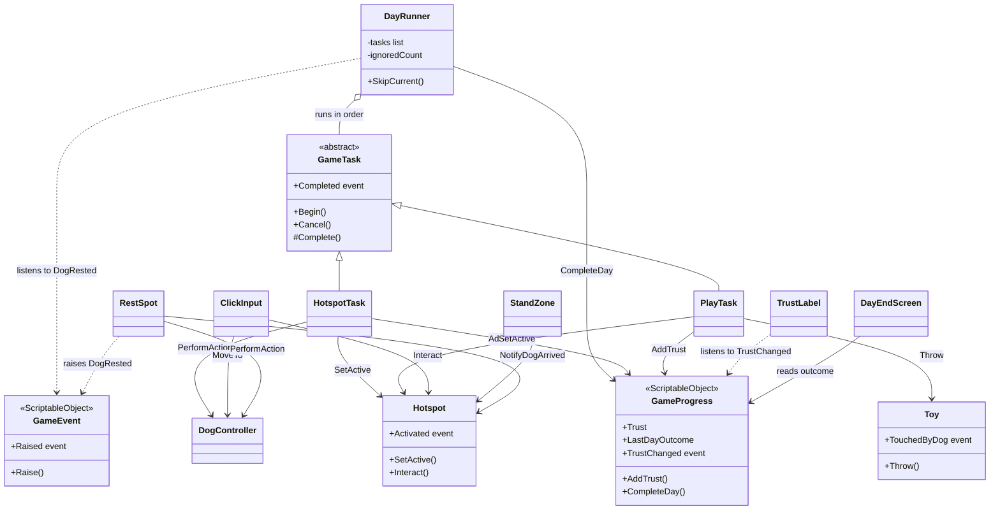

# Inumamotchi 犬守っち

*Every good boy knows how to take care of his human!*

A 2D isometric point-and-click game where the player is a dog taking care of its owner.
This build is the core loop for assignment 4: one day (the Tutorial day plus a Play task), physics, and the code architecture.

- [Play in the browser] (https://kohaku-inu.itch.io/inumamotchi)
- [Formal elements](Docs/formal-elements.md)
- [Level design](Docs/level-design-four-difficulty-levels.md)
- [All scripts](Assets/Scripts)
- [Watch play test](https://youtu.be/5Y6MoOUjQeQ)
---

## How to run

**In the browser:** open the itch.io link above.

**In Unity:**
1. Open the project in Unity 6 (6000.x) with the Web Build Support module.
2. Open `Assets/Scenes/Tutorial.unity`.
3. Press Play.

Before building, reset `Assets/Data/GameProgress.asset` (right-click the component header → *Reset values*), because the build starts from the values saved in the asset.

## How to play

Click the floor to walk the dog around. The day's tasks come in a fixed order. The spot for the current task glows; click it to send the dog there.

1. **Wake:** click the glowing spot on the bed. The dog jumps.
2. **Breakfast:** a scent trail leads to the bowl by the door. Click the bowl.
3. **Walk:** click the door.
4. **Play:** a glowing ball appears on the rug. Click it, and the dog brings it to the owner, who throws it. Click the ball again to chase it. Catching it while it's still rolling fast gives bonus Trust.
5. **Bedtime:** click the bed. The day ends.

**Rest:** at any time, click the sunbeam on the floor (bottom left). The dog lies down, time passes, and the current task is skipped.

Trust is shown in the top-left corner and rises with each completed task.

*Prototype note:* the characters use placeholder animations, and the owner is not drawn yet.

### Win / lose

The design has no game over, so the two endings are a **Warm Day** and a **Quiet Day**:

- **Warm Day:** fewer than 2 tasks ignored. The end screen is warm.
- **Quiet Day:** 2 or more tasks ignored (skipped by resting). The end screen is dim and quiet.

The threshold is the `Quiet Day Threshold` field on `DayRunner`.

In the browser version the Exit button on the end screen is hidden, because a web page can't quit.

---

## Folder structure

```
Assets/
├── Data/             GameProgress.asset, DogRested.asset (event)
├── Prefabs/          GlowLight, ScentWisp, TapRipple
├── Scenes/           Tutorial, DayEnd
└── Scripts/
    ├── Day/          DayRunner, DayOutcome
    ├── Dog/          DogController
    ├── Effects/      ScentEmitter, ScentWisp
    ├── Events/       GameEvent (ScriptableObject event)
    ├── Interaction/  ClickInput, Hotspot, StandZone, RestSpot, TapRipple
    ├── Play/         Toy
    ├── Stats/        GameProgress (ScriptableObject)
    ├── Tasks/        GameTask (abstract), HotspotTask, PlayTask
    ├── UI/           TrustLabel, DayEndScreen
    └── FitCameraToBackground
```

---

## Class relationships



Solid arrows are direct calls. Dotted arrows are event connections.

### Events: who sends, who listens

| Event | Raised by | Listened to by | What happens |
|---|---|---|---|
| `Hotspot.Activated` | `Hotspot`, when the dog arrives | `HotspotTask`, `RestSpot` | The task's action starts / the dog rests |
| `GameTask.Completed` | each task, through `Complete()` | `DayRunner` | The next task starts |
| `Toy.TouchedByDog` | `Toy`, in `OnCollisionEnter2D` | `PlayTask` | First touch: the owner throws. Second touch: caught |
| `GameProgress.TrustChanged` | `GameProgress`, in `AddTrust` / `ResetAll` | `TrustLabel` | The Trust text updates |
| `DogRested` (GameEvent asset) | `RestSpot`, when the rest ends | `DayRunner` | The current task is skipped |

Every listener subscribes in `OnEnable` and unsubscribes in `OnDisable`, except task subscriptions, which `DayRunner` adds when a task starts and removes when it ends. `DayRunner.OnDisable` also removes the current one as a safety net.

---

## Architecture decisions

**1. The UI listens to the game, not the other way round.**
`GameProgress` raises `TrustChanged`, and `TrustLabel` listens.
*Alternative:* `GameProgress` updates the label directly, or the label checks the value every frame in `Update`.
*Why:* the game code doesn't depend on the UI, and new listeners (a sound, a meter) can be added without changing `GameProgress`. The label only works when something actually changed.

**2. Rest talks to the day through an event asset.**
`RestSpot` raises the `DogRested` asset (a ScriptableObject `GameEvent`), and `DayRunner` listens to the same asset.
*Alternative:* `RestSpot` holds a reference to `DayRunner` and calls `SkipCurrent()`.
*Why:* neither class knows about the other. The event is named after what happened ("the dog rested"), so each listener decides what it means. Later the energy meter will listen too and restore energy, with no change to `RestSpot`.

**3. A day is a list of tasks that share one contract.**
Every task inherits from `GameTask` (`Begin`, `Cancel`, `Completed`). `DayRunner` only runs the list in order and doesn't know what each task does.
*Alternative:* one big day manager with a switch over all tasks.
*Why:* a new task doesn't change `DayRunner`. Simple tasks are set up in the Inspector with no new code.

---

## How to add a new task

**A simple task** (go to a spot and do one action, like Dinner): no code changes.
1. Duplicate a hotspot in the scene (Ctrl+D), move it, and place its StandPoint.
2. Drag the `GlowLight` prefab onto the new hotspot and assign it to the hotspot's `Highlight` field.
3. Create an empty object under `Tutorial`, add `HotspotTask`, and set the hotspot, the dog action and the Trust reward.
4. Add it to the `Tasks` list on `DayRunner`, in the right place.

*Files changed:* `Tutorial.unity` only.

**A task with a new mechanic** (like a timing ring):
1. Create `NewTask.cs` in `Scripts/Tasks/`, inheriting from `GameTask`.
2. Implement `Begin()` and `Cancel()`, and call `Complete()` when done.
3. Add it to the scene and to the `DayRunner` list as above.

*Files changed:* the new script and `Tutorial.unity`. `DayRunner`, `ClickInput` and `GameProgress` don't change.

**A new dog action** (like Bark with its own animation): add it to the `DogAction` enum and handle it in `DogController.ActionRoutine`.

---

## Singletons and static variables

There are no custom singletons or static variables. The code only uses Unity's built-in static accessors: `Camera.main`, `EventSystem.current`, and `Pointer.current` (Input System).

Data shared across scenes (Trust, day count, the last outcome) lives in the `GameProgress` ScriptableObject asset instead of a singleton. Every script that needs it gets it through an Inspector reference, so the dependency is visible.

---

## Physics

| Feature | Where | How |
|---|---|---|
| Raycast | `ClickInput` | `Physics2D.GetRayIntersectionAll` from the camera through the cursor finds the clicked hotspot |
| Rigidbody2D (Dynamic) | `Toy` | The ball is moved by physics. Gravity 0 (top-down floor), linear damping as floor friction |
| AddForce / AddTorque | `Toy.Throw` | Impulse force for the throw, impulse torque for the spin |
| Collision2D | `Toy.OnCollisionEnter2D` | Checks that the other object is the dog (`collision.gameObject`) and reads `collision.relativeVelocity` to decide a good catch |
| Triggers | `StandZone` | `OnTriggerEnter2D` detects that the dog arrived at a hotspot |
| Rigidbody2D (Kinematic) | Dog | Moved by code, but still detected by triggers and collisions |
| CharacterController | **WATTching** (my other game) | [link — add here] |

---

## Visuals

- **Active spot glow:** each hotspot has an optional `Highlight` object. The `GlowLight` prefab is a URP 2D light that `Hotspot.SetActive` switches on and off together with the hotspot.
- **Camera:** `FitCameraToBackground` zooms the camera so the background fills the screen with no empty bars, and refits when the window size changes (for example, browser fullscreen).

---

## AI review: code vs. diagram

The code was checked against the class diagram and events table above by an AI agent (Claude). The differences, the known limitations, and the planned fix for each are below. The fixes are planned for the next iteration.

### Differences from the diagram

| # | Where | Difference | Why it is this way now | Planned fix |
|---|---|---|---|---|
| 1 | `HotspotTask`, `RestSpot` → `ClickInput` | Both set `ClickInput.InputLocked` directly to lock the world during an action. This link is not in the diagram. | The simplest way to lock input for a prototype. | Replace the direct calls with two `GameEvent` assets, `ActionStarted` and `ActionEnded`. Tasks raise them, and `ClickInput` listens and locks or unlocks itself. Tasks then no longer need a reference to `ClickInput`. |
| 2 | `Hotspot`, `StandZone`, `Toy` → `DogController` | `Hotspot` reads the dog's `State` and `MoveTarget` to tell "arrived" from "walking past". `StandZone` and `Toy` recognize the dog by its `DogController` component. Not drawn. | These are checks, not commands, and were left out to keep the diagram readable. | Add these dependencies to the diagram as dotted "reads" arrows. No code change needed. |
| 3 | `HotspotTask`, `PlayTask` | They subscribe to `Hotspot.Activated` / `Toy.TouchedByDog` in `Begin()` and unsubscribe in `Cleanup()`, not in `OnEnable` / `OnDisable`. | A task should only listen while it is running. | Keep the Begin/Cleanup pattern, and add an `OnDisable` safety net that unsubscribes if the object is disabled mid-task, the same pattern `DayRunner` already uses. |
| 4 | `GameProgress.ResetAll` | Resets Trust and the day count, but not `LastDayOutcome`. | An oversight found by this review. | Add `lastDayOutcome = DayOutcome.Warm;` to `ResetAll()`. |
| 5 | Small classes | `ScentEmitter`, `ScentWisp`, `TapRipple`, `FitCameraToBackground` and the `DayOutcome` enum are not in the diagram. | Visual helpers and a value type, left out on purpose. | No change planned. |

### Other findings and known limitations

| Type | Finding | Planned fix |
|---|---|---|
| Code quality | `DogController` has two responsibilities: moving the dog and performing actions. | Split it into `DogMover` (walking, `MoveTo`) and `DogActions` (`PerformAction` and the animations). Scripts that use the dog then reference only the part they need. |
| Code quality | `DogController` has fixed numbers in the code: the arrival distance (`0.05f`) and the placeholder animation sizes and times. | Move the arrival distance to an Inspector field. The animation numbers are removed when the placeholders are replaced by Animator animations. |
| Project structure | The `Scripts/Owner` and `Scripts/Walk` folders are empty. Git stores their `.meta` files but not the folders. | Delete the empty folders, and create them again when owner and walk code is added. |
| Project structure | `FitCameraToBackground` sits loose in `Scripts/`. | Move it into a `Camera/` folder. |
| Known limitation | The ball can roll out through the bottom edge of the house (no wall colliders yet). | Add a solid `EdgeCollider2D` along the house walls, so the ball bounces back. |
| Known limitation | When clickable objects overlap, the click does not follow sprite drawing order. This is not a problem yet, because only one task hotspot is active at a time. | Sort the raycast hits by sorting layer and order in layer before choosing a hotspot. Needed once several hotspots can be active at the same time. |
| Known limitation | On 16:10 screens the camera crops the mailbox, which is used only in the Hard level. | Limit how much `FitCameraToBackground` may crop, and fill any remaining edge with a colour from the art instead of the camera's default blue. |
