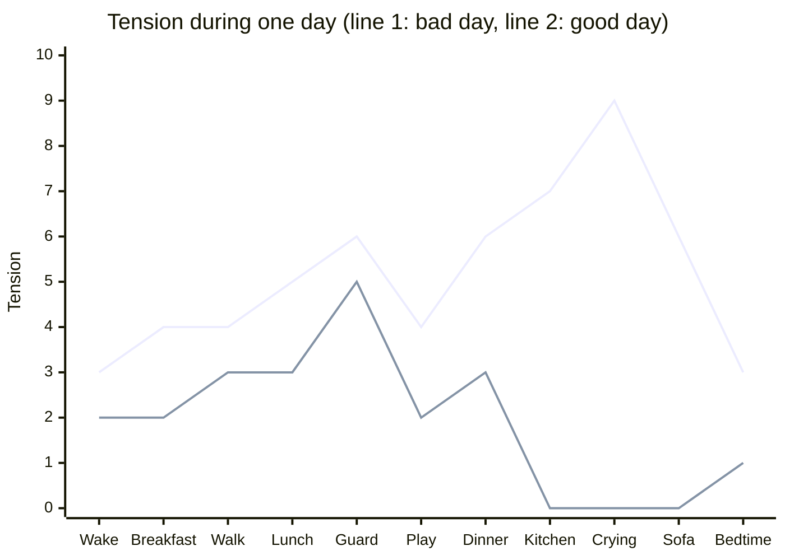
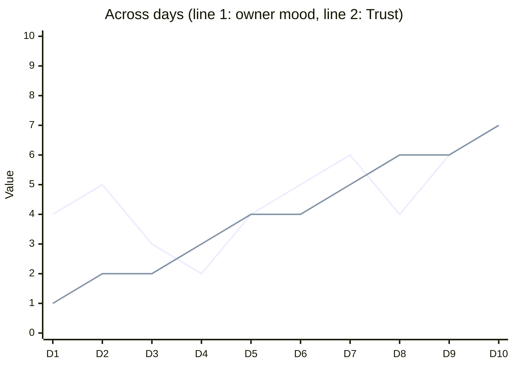

# Inumamotchi 犬守っち — Dramatic Elements

*Every good boy knows how to take care of his human!*

This document covers the dramatic elements of Inumamotchi (assignment 5). It builds on:

- [Formal elements](formal-elements.md)
- [Level design: four difficulty levels](level-design-four-difficulty-levels.md)
- [Market research](Market_Research.md)
- [Main README](../README.md)

Numbers marked *(placeholder)* still need playtesting.

---

## 1. Challenge

### 1.1 Skills the game requires

The game is built for "no reflexes required", so the skills are mostly about attention and reading, not speed.

| Skill | Where it is used | Example |
| --- | --- | --- |
| **Reading body language** | Every task. The owner's mood is never shown as a number  | After Breakfast, the owner walks slowly and leaves food on the plate. The player has to notice this, because it means the Walk will be cut short and the next tasks will need ladders. |
| **Following visual cues** | Instinct prompts  | A glow on the bed, a scent trail to the bowl, a picture in the dog's thought bubble. |
| **Timing (forgiving)** | Timed presses: Wake (Jump), Desk Break (Paw), Guard (Bark), Play (Catch) | A ring shrinks toward a target zone; the player presses while it is inside. In the current build, catching the ball while `collision.relativeVelocity` is high gives bonus Trust. |
| **Planning a day's Energy** | Energy pool of 100 *(placeholder)*, Rest in the sunbeam | On Hard, a worst-case day uses 99 of 100 Energy, so skipping Rest and climbing every ladder leaves almost nothing. |
| **Patience / persistence** | Escalation ladders, night stops, Floor and Crying events | Rung 3 is always a held Stay: the skill is to keep holding and not leave. |
| **Prioritising** | Instinct vs. obligation  | The walk detour (chasing something pointless) costs time; the player chooses whether it is worth it. |

### 1.2 Three manually selected difficulty levels

The level-design document already defines **four** levels (Tutorial, Easy, Normal, Hard). For a three-level menu, the **Tutorial is not a menu choice**: it always runs first, and the menu offers Easy, Normal and Hard.

**Design rule:** levels change only *how much day there is* (task count) and *how deep the escalation ladder goes*. Timing windows, the Energy pool, rung cost, mood bands, Trust values and the thought-bubble clues are the same on every level.

**What changes, object by object**

| What changes | Easy | Normal | Hard |
| --- | --- | --- | --- |
| `DayRunner.tasks` list | 6 tasks: Wake, Breakfast, Walk, Play, Dinner, Bedtime | 8: adds Lunch Nudge, Guard | 10: adds Fetch Post, Desk Break |
| New hotspot objects in the scene | — | Desk hotspot (Lunch Nudge), window/door Guard markers | Red wall box (Fetch Post), letter sprite, desk hotspot for Desk Break |
| Escalation depth (max rungs) | 1, only on Wake, Breakfast, Dinner | 2, on every task except Bedtime | 3, on every task except Bedtime |
| Night stops on a bad day | 1: Sofa | 2: Kitchen, Sofa | 3: Desk, Kitchen, Sofa |
| Base Energy use *(placeholder)* | 50 / 100 | 62 / 100 | 72 / 100 |
| Worst-case Energy use | 53 | 76 | 99 |
| Bad day possible | Yes | Yes | Yes |

**Programming guideline.** Each level becomes a `LevelConfig` ScriptableObject, so a level is data, not code — the same approach as `GameProgress`:

```csharp
[CreateAssetMenu(menuName = "Inumamotchi/Level Config")]
public class LevelConfig : ScriptableObject
{
    public string displayName;           // "Easy", "Normal", "Hard"
    public List<TaskId> tasks;           // the day's tasks, in order
    public int escalationDepth;          // 1, 2 or 3
    public List<TaskId> tasksWithLadder; // Easy: Wake, Breakfast, Dinner
    public List<NightStopId> nightStops; // used only on a bad day
}
```

`DayRunner` receives the chosen `LevelConfig` at Day Initialisation and enables only the task objects whose `TaskId` is in `tasks`. The menu writes the choice into `GameProgress.SelectedLevel`, so it survives the scene change.

### 1.3 Dynamic difficulty adjustment (DDA)

*Not covered in earlier documents.* Two existing systems already adapt the day, but neither measures skill:

- **Bad days** come from the owner's mood (neglect, Drift), not from how skilled the player is.
- **Ladders** go deeper when the owner's mood is lower, not when the player is weaker.

So DDA is a new, third layer. Because the game promises "no reflexes required", DDA only ever makes the **timing and the clues** easier or harder. It never changes Trust rewards, never adds punishment, and never changes the level's task list.

**What the game measures** (a new `SkillTracker` component, listening to existing task events):

| Signal | How it is measured | Source in the code |
| --- | --- | --- |
| Timing hit rate | Hits ÷ timed presses over the last 8 timed presses (rolling window) | Timed tasks report `Hit` / `Miss` when they resolve |
| Press accuracy | Distance of the press from the centre of the target zone, 0 (centre) to 1 (edge) | The ring UI at the moment of the press |
| Prompt reaction time | Seconds from "prompt fires" (`Hotspot.SetActive(true)`) to the click on the right target | `Hotspot.Activated` timestamp minus the `SetActive` timestamp |
| Wrong clicks | Clicks on the floor or on inactive hotspots while a prompt is showing | `ClickInput` |
| Ignored tasks | Count of tasks skipped by Rest | `DayRunner.ignoredCount` (already exists) |

**How it adapts** — a single value `skill` from 0 to 1, updated after each timed press:

```
skill = 0.6 * hitRate + 0.4 * (1 - averageAccuracyDistance)
```

| Parameter | Low skill (skill < 0.35) | Default (0.35–0.75) | High skill (skill > 0.75) |
| --- | --- | --- | --- |
| Ring target-zone width | +30% wider | as authored | −20% narrower |
| Ring shrink time | +0.4 s slower | as authored | −0.2 s faster |
| Prompt hint delay (bubble re-shows the picture) | after 4 s of no correct click | after 8 s | after 15 s |
| Scent-trail density (`ScentEmitter` spawn rate) | ×1.5 | ×1 | ×0.7 |

Rules that keep DDA invisible and fair:

1. **Small steps.** The zone width moves at most 10% per press, so the player never feels a jump.
2. **Hysteresis.** A change only happens after the same band holds for 3 presses in a row.
3. **Floor and ceiling.** The zone is never narrower than 60% of the authored width, so "no reflexes required" stays true.
4. **Saved between days.** `skill` is stored in `GameProgress`, so day 2 starts where day 1 ended.
5. **Never on emotional moments.** Night stops, Floor and Crying events have no timing, so DDA does not touch them.

**Open decision:** the level-design document says timing windows are *the same at every level*. DDA changes them *per player*, not per level, so the two rules do not contradict, but this should be confirmed in playtesting.

---

## 2. Flow

### 2.1 Focusing attention and avoiding distraction

| Technique | Implementation |
| --- | --- |
| **One active target at a time** | `DayRunner` runs tasks in order, and only the current task's `Hotspot` is active. Inactive hotspots ignore clicks. |
| **Light, not icons** | The active hotspot's `GlowLight` (URP 2D light) is switched on by `Hotspot.SetActive`. Light draws the eye without covering the art with floating markers. |
| **World lock** | While a task UI is open, `ClickInput.InputLocked = true`, so a stray click can't send the dog away mid-task. |
| **Picture-only thought bubble** | Shows what to do, never why, never long text. It fades on the correct click. |
| **No real-time clock** | Nothing runs against the real clock, so the player is never rushed. |
| **Calm audio** | Ambient sound stays low; it fades further only for the Crying event, which marks it as special. |
| **One screen** | A single painted house plus the walk view. No menus or inventories during play. |
| **Minimal HUD** | Three meters (Energy, Appetite, Trust). Each appears only the first time it changes (Tutorial). |

### 2.2 Sense of control and meaningful actions

- **Immediate response to every click.** A click on the floor plays the `TapRipple` effect and the dog walks there (`DogController.MoveTo`). The player sees that the input landed before anything else happens.
- **The dog moves physically.** The ball in Play is a dynamic `Rigidbody2D`; the throw uses `AddForce` and `AddTorque`. The catch is checked in `OnCollisionEnter2D`, so how fast and where the player sends the dog changes the result.
- **Visible consequences inside the day.** A hit on Wake makes the owner sit up and pet the dog; a miss makes the owner roll over.
- **Visible consequences across days.** Ignored tasks feed Drift: the next morning the owner sleeps longer and eats less. The player sees that yesterday's choices shaped today.
- **Free choices that are always allowed.** Rest at any time in the sunbeam, take the walk detour or not, choose any comfort action in a Crying event.

### 2.3 Feedback on success and failure

There is no "fail", so feedback is graded, not binary.

| Result | Visual | Audio | Numbers |
| --- | --- | --- | --- |
| **Complete (hit)** | Owner reacts at once: pets the dog, smiles. The dog's tail wags fast. | Happy bark, short chime | Trust +N, shown rising in the top-left label (`TrustLabel` listens to `TrustChanged`) |
| **Partial** | Task ends, owner reacts flatly (eats little, short walk) | Neutral sound | No Trust gain |
| **Missed timing, good day** | Owner rolls over or glances away; prompt returns after a short delay | Soft "hmm" | None |
| **Missed timing, bad day** | Ladder starts; the bubble shows the next rung's picture | Low whine | Small Trust gain when a rung lands |
| **Fast ball catch** | Extra owner reaction | Extra chime | Bonus Trust (current build, `relativeVelocity` check) |
| **End of day** | Warm Day: warm end screen. Quiet Day: dim, quiet end screen (`DayEndScreen`) | Matching music | No score, no grade |

**Misread feedback** is also part of the comedy: after a Guard bark, the owner gives a short pet that means "stop", and the bubble shows a medal. The player sees both the truth (owner's face) and the dog's reading (bubble).

---

## 3. Fun

### 3.1 Nice things to do that are not the goal

Already in the design:

- **Walk detour:** chase something pointless (a butterfly, a leaf) during the Walk.
- **Free roaming:** click anywhere on the floor and the dog walks there, with the `TapRipple` effect.
- **Ball physics:** the ball rolls, spins and can be chased again just for fun.
- **Sofa night stop:** the optional extra beat of tugging the orange throw over the owner.
- **Sunbeam:** lie in the light at any time.

**proposed additions** (all reuse objects already in the art, from the level-design backlog):

| Activity | What happens | Reward |
| --- | --- | --- |
| Push the orange pouf | The pouf is a dynamic `Rigidbody2D`; clicking it makes the dog nose it across the rug | None — just physics fun |
| Bark at the TV | Clicking the TV while the owner watches it | The owner laughs once per day (a tiny mood boost, no Trust) |
| Look at the pictures on the wall | The dog sits under the photos; the owner sometimes looks up | Unlocks a backstory fragment (see §5) |
| Steal a slipper | Carry a slipper around and drop it anywhere | The owner finds it later in a funny place |
| Chase your own tail | Double-click the dog | Pure animation, costs 1 Energy |

### 3.2 Player types


| Type | Fit | Why |
| --- | --- | --- |
| **Explorer** | Strong | The story is implicit: clues in the house, the owner's behaviour, letters, photos. Explorers who look closely are rewarded for "seeing more". |
| **Socializer / Storyteller** | Strong (with the owner, not other players) | The core is a relationship. Trust and the Bond Deepened moments serve players who play for the connection. |
| **Achiever** | Medium | Trust rises forever, timing bonuses, Deep Days — but there is no score screen by design. |
| **Competitive** | Weak | No competition, no opponents, no way to "win" against anyone. This is intentional (tonal boundary: no cruelty). |

Matching the market research, the core audience is cozy-game players (mostly women in their 20s–30s) and children, plus story-driven players who come for the dog's point of view.

### 3.3 Adding more player types

| Type | What to add | Notes |
| --- | --- | --- |
| Achiever | Achievements for repeated or chained actions (already in the market research meta-game), a collection page of unlocked scenes, a "perfect timing" streak counter | Must stay hidden from players who don't care, to keep the "no score" tone |
| Socializer (between players) | Share a screenshot of the day-end screen; seasonal live events that many players experience at the same time (§10) | No chat, no PvP |
| Creative / Artists | Cosmetic room items and outfits (the planned monetization) | Popular in cozy games |
| Competitive | A personal-best speed run of the Play mini-game against yourself | Optional, away from the main day |

---

## 4. Emotions

### 4.1 Emotions the player should feel

| Emotion | When |
| --- | --- |
| **Warmth / tenderness** | Owner pets the dog, Bond Deepened animation, the dog settling by the bed |
| **Amusement** | The dog's misreadings in the bubble (a "stop" pet drawn as a medal; a pigeon treated as an intruder) |
| **Curiosity** | Noticing something is off with the owner; wanting to know why |
| **Concern** | A bad day: the owner doesn't get up, eats little, stays at the monitor at night |
| **Quiet guilt (not punishment)** | After ignoring tasks: the house is quieter the next day |
| **Relief** | A ladder lands, the owner finally sits up; the end of a crisis |
| **Being needed** | Rung 3 and night stops: the dog does nothing except stay, and that is enough |

### 4.2 How the design creates them

| Design tool | Emotion | Concrete example |
| --- | --- | --- |
| **Perspective inversion** | Warmth, amusement | The player is the dog, so every misunderstanding is the player's own funny mistake |
| **Contrast between bubble and reality** | Amusement, then sadness | Bubble shows a medal while the owner's face shows exhaustion |
| **Light and colour** | Concern, relief | Night tint with warm light pools; desaturation only during Crying; colour returns when it ends |
| **Sound** | Concern | Ambient sound fades before a Crying event |
| **Pace** | Concern | On a bad day the owner walks slower and puts on shoes slower |
| **Safety mechanic** | Relief, being needed | Any comfort action helps; only inaction prolongs the crisis |
| **No score at day end** | Reflection | The silent summary leaves room to think about the day instead of a grade |
| **No healing ending** | Bittersweet realism | The game never "cures" the owner; tomorrow is another day |

---

## 5. Backstory

### 5.1 What happened before the game started


- About a year ago, the owner moved alone to this small house in a new town to get away from family and for a remote desk job. The move was meant to be a fresh start.
- Shortly after, the owner adopted the dog from a shelter. The dog doesn't know any of this; for the dog, life began in this house.
- The **photos on the left wall** show people (family, old friends) who used to be close. They don't visit.
- The **letters in the red wall box** (Fetch Post, Hard) are from the owner's family. The owner often leaves them unopened.
- The **desk with the monitor** is where most of the owner's day goes; work has slowly taken over meals and walks.
- The owner's low mood has been building for months. The game never names it.

### 5.2 How the backstory reaches the player

The narrative boundary says nothing is explained directly, so the backstory is delivered through **environmental storytelling**, filtered by what a dog can notice plus changes in enviroment (dirty dishes, hills of clothes waiting for laundry):

| Channel | Example |
| --- | --- |
| **Objects in the house** | Photos on the wall, unopened letters, the second chair at the dining table that is never used |
| **Owner behaviour** | Looking at the photos, putting a letter aside, staying at the monitor late |
| **Dog's thought bubble** | The dog's (wrong) reading: a photo of the family is drawn as "pack — where?" |
| **Unlockable scenes** | Short scenes unlocked by achievements or Deep Days (market research §6): the owner on the phone with family, the day they adopted the dog |
| **Day-to-day change** | On Deep Days the owner opens a letter or calls someone; the player connects the pieces |

Programming guideline: each fragment is a `StoryBeat` ScriptableObject with an `id`, a trigger condition (e.g., `minTrust`, `requiresDeepDay`, `requiresInteraction = "LookAtPhotos"`) and a short animation/scene. `GameProgress` keeps a list of seen beat ids, so a beat plays once.

---

## 6. Characters

### 6.1 Main characters

| Role | Character | Notes |
| --- | --- | --- |
| **Hero** | **The dog** (player character) | Loyal, curious, often wrong about humans. Cannot speak or use tools; acts through body language, sound and presence. |
| **The one being cared for** | **The owner** | A young adult living alone, quiet, kind, tired. Not an antagonist. |
| **Main opponent** | **No villain.** The opposing force is the owner's low mood and inertia (formal elements §7: player vs. environment) | It is shown as *Drift*: the house getting quieter, the owner sleeping longer. It can be pushed back, never defeated. |

### 6.2 Secondary characters

*These are proposed and reuse existing tasks: will change according based on development work*

| Character | Where | What it adds |
| --- | --- | --- |
| **The pigeon** | Guard task, at the window | Comic relief: the dog's "intruder". A recurring gag that grows over days (it starts bringing a friend). |
| **The mail carrier** | Fetch Post (only the sound and a shadow through the door window) | The link to the outside world and the family letters |
| **The squirrel** | Walk view | The "instinct vs obligation" conflict in one character: the detour target |
| **A neighbour with another dog** | Walk view | Shows what a lighter, social life looks like; on Deep Days the owner stops to talk |
| **Family (offscreen)** | Photos, letters, a phone call scene | Backstory; never seen in person in the base game |

### 6.3 How characters change during the game

| Character | Change | Driven by |
| --- | --- | --- |
| Owner | Responds faster, eats more, starts acting unprompted on Deep Days (formal elements §9) | Trust and owner mood |
| Owner | Bad days still come back; there is no permanent cure | Design rule: no healing ending |
| Dog | Its readings become more accurate on Deep Days (the bubble misreads less) | Trust |
| Dog | New subtle interactions unlock after a Breakthrough | Bond Deepened |
| Pigeon | Escalating gag (one pigeon → two → a nest) | Day count |

### 6.4 Do they behave with "free will"?

Yes, the **owner** is designed to look autonomous:

- **Own schedule.** The owner follows a daily route (bed → kitchen → desk → sofa) without the player.
- **Own pace.** Mood sets walking speed, shoe time and how much food is eaten.
- **Unprompted actions.** On Deep Days the owner calls the dog, starts a game or opens a letter alone.
- **Reacts in their own time.** Rung 3 is a held Stay: the owner decides when to respond.

The owner runs a simple **utility AI** — each possible idle action (`StayAtDesk`, `GoToSofa`, `LookAtPhotos`, `CallDog`) has a score from mood, Trust and time of day, with a small random factor, and the highest score wins. This gives believable "will" without scripting every moment. The dog is controlled by the player, but small autonomous idle animations (scratching, sniffing) keep it alive between clicks.

---

## 7. Plot

### 7.1 Dramatic arc

The game has two arcs: a **short arc inside each day**, and a **long arc across days**.

**Arc of one day (Normal level).** Line 1 = tension on a bad day, line 2 = tension on a good day.



- **Exposition:** Wake. The player reads the owner's state.
- **Rising action:** tasks that need more effort; ladders on a bad day; Guard is a small spike.
- **Breather:** Play — the lightest moment of the day.
- **Climax:** on a bad day, the Crying or Floor event, usually at night.
- **Falling action and resolution:** the Sofa stop, then Bedtime. The day resolves quietly.

**Arc across days.** Trust rises steadily and never drops; owner mood rises in waves with setbacks.



The shape is a **rising sawtooth**: each bad stretch is a small crisis, but the bond keeps growing, so every recovery reaches a little higher.

### 7.2 The plot and how it follows the arc

| Act | Days *(placeholder)* | Plot | Arc stage |
| --- | --- | --- | --- |
| **1. A normal house** | 1–2 (Tutorial, Easy) | Routine. The owner seems fine, a bit tired. The dog learns the house. Funny misreadings. | Exposition |
| **2. Something is off** | 3–5 | First bad day. The owner doesn't get up; the first Crying event. Letters pile up. | Rising action |
| **3. The low point** | Around 5–7 (or after neglect) | Several bad days; a long night. The dog only stays. | Climax |
| **4. Small steps** | After the low point | The owner opens a letter, calls someone, takes a longer walk, plays unprompted. | Falling action |
| **5. Tomorrow** | Ongoing | No final cure. Good and bad days continue, but the bond is stronger. | Open resolution |

Act 3 is not fixed to a day number: it is triggered by the owner-mood system, so it comes earlier for players who neglect the owner.

### 7.3 How player behaviour changes the plot

| Player behaviour | Effect on the plot |
| --- | --- |
| Completes tasks attentively, good timing | Higher mood; earlier Deep Days; story beats about reconnecting (opening letters, phone call) unlock sooner |
| Ignores tasks / rests through them | Drift: more bad days; Act 3 arrives sooner and lasts longer |
| Comforts during breakdowns | Breakthrough: Bond Deepened animation, a new interaction, a backstory scene |
| Does nothing during breakdowns | The event lasts longer; the next day starts lower |
| Explores (photos, letters) | Unlocks backstory fragments the player would otherwise never see |

Programming guideline: the plot is a set of `StoryBeat` assets (see §5.2). At Day Initialisation, `DayRunner` asks a `StoryDirector` for the first beat whose conditions are met (Trust ≥ X, days since last bad day, beats already seen), and places it in a free slot of the day.

### 7.4 Twine prototype - NEED CHANGING

The Twine version is a short meta-game story over three days, with two variables: `$trust` (only rises) and `$drift` (neglect).

- **Source:** [`Twine/inumamotchi-story.twee`](../Twine/inumamotchi-story.twee)
- **Playable HTML:** `Twine/inumamotchi-story.html` *(export from Twine — see below)*

To build the HTML: open [twinery.org](https://twinery.org) → **Library** → **Import** → choose the `.twee` file → open the story → **Build** → **Publish to File**. Commit the `.html` next to the `.twee`.

---

## 8. World building

| Aspect | The world of Inumamotchi |
| --- | --- |
| **Laws of nature** | The real world, seen through dog senses. Smells are visible (scent trails). Time moves only when the dog acts or rests, never with the real clock. The dog's Energy and Appetite always refill overnight; the owner's mood never refills by itself. Trust never decreases. Physics is simple: the ball rolls on a frictiony floor (`Rigidbody2D`, gravity 0, linear damping). |
| **Geography** | One small house (bedroom, bathroom, kitchen, entry, dining nook, living area, desk, sunbeam — see the level-design house map) plus one fixed neighbourhood walking route. To the dog, the house is the whole world, and the walk is "the outside". |
| **History** | See the backstory (§5): the owner moved here alone about a year ago and adopted the dog. The dog's history begins in this house. |
| **Economy** | Three currencies: **Energy** (dog's daily budget, spent on tasks and rungs, refilled by sleep and Rest), **Appetite** (dog's and owner's, refilled by meals), **Trust** (long-term savings, earned only, never spent). The owner's mood is the "market" that sets how expensive each task is that day (ladders cost more Energy). |
| **Society** | A pack of two. In the dog's mind, the owner is the pack leader who needs protecting. Outside the house: the neighbour and their dog, the mail carrier, the pigeon. |
| **Politics** | Household power is reversed from what the dog believes: the dog thinks it serves the leader, but in practice the dog sets the rhythm of the house (meals, walks, bedtime). The dog has no words, only influence: nudges, presence, persistence. |

### How the player learns the world

1. **Tutorial teaching by doing:** each meter appears the first time it changes; each prompt type appears once (glow, scent trail, leash, bed).
2. **The thought bubble** explains the dog's world view in pictures — including its mistakes.
3. **Exploration:** free walking around the house, clicking objects, the walk view.
4. **Consequences:** the player learns the economy by seeing a tired dog after skipping Rest, or a quiet house after ignoring tasks.
5. **Story beats** reveal history gradually (§5.2).

---

## 9. Meta-game


| Meta-game type | Fits? | How it appears in Inumamotchi |
| --- | --- | --- |
| **Persistent progression between sessions** | Main type | Trust carries across all days and never resets (`GameProgress` asset). Owner state is written forward every day. |
| **Narrative / story unlocks** | Main type | Backstory scenes unlocked by Trust, Deep Days and achievements. The Twine story (§7.4) is a prototype of this layer. |
| **Achievements / collection** | Yes | Achievements for repeated or chained actions; a gallery of unlocked scenes and Bond Deepened moments. Optional, never shown as a score. |
| **Unlockable interactions** | Yes | Each Breakthrough unlocks a new subtle interaction for future days. |
| **Live events / seasonal content** | Yes | Holiday redecoration of the house and characters, special funny situations. See §10. |
| **Customisation (cosmetic)** | Yes | Decorating the house and the dog, the planned in-app purchase model. Cosmetic only, no gameplay advantage. |
| **Leaderboards / PvP** | No | Against the tone (no competition, no score). |

The strongest fit is **persistent progression + narrative unlocks**: the reason to play another day is to learn more about the owner and see the bond deepen.

---

## 10. Live Ops

### 10.1 How it works

The game loads a JSON configuration file from the GitHub repository at startup. Changing the JSON on GitHub changes the game for every player on their next launch — no new build, no new itch.io upload.

```
GitHub repo: LiveOps/live-config.json
        │  (UnityWebRequest at startup, 5 s timeout)
        ▼
LiveConfigLoader ──► LiveConfigAsset (ScriptableObject, holds Current + Changed event)
        │                    │
        │ on failure:        ├──► LiveEventDecorations  (turns the winter props on/off)
        │ last saved copy    ├──► HotspotTask / PlayTask (multiply the Trust reward)
        │ → built-in default └──► DayRunner             (Quiet Day threshold)
```

The design follows the same patterns as the rest of the code (README, *Architecture decisions*):

- The data lives in a **ScriptableObject asset**, like `GameProgress`, not a singleton.
- Listeners **subscribe to a `Changed` event** in `OnEnable` and unsubscribe in `OnDisable`, like `TrustLabel`.
- The loader doesn't know who uses the config.

**Fallback order:** remote JSON → the last JSON that loaded successfully (saved in `PlayerPrefs`) → default values in the asset. The game never waits for the network to start, and never breaks if GitHub is down.

### 10.2 The configuration file

`LiveOps/live-config.json` (in the repository root):

```json
{
  "version": 2,
  "eventId": "winter_lights",
  "eventStartUtc": "2026-12-04T00:00:00Z",
  "eventEndUtc": "2026-12-13T23:59:59Z",
  "eventTrustMultiplier": 2.0,
  "eventDecorations": true,
  "quietDayThreshold": 2
}
```

| Field | Meaning |
| --- | --- |
| `version` | Raised on every edit, for debugging |
| `eventId` | Which live event; empty `""` = no event |
| `eventStartUtc`, `eventEndUtc` | When the event is active (UTC, ISO 8601) |
| `eventTrustMultiplier` | Trust reward multiplier while the event is active |
| `eventDecorations` | Show the event props in the house |
| `quietDayThreshold` | Live tuning: how many ignored tasks make a Quiet Day (always applied, event or not) |

### 10.3 The code

**`LiveConfig.cs`** — the data. `JsonUtility` needs public fields (not properties) and `[Serializable]`.

```csharp
using System;
using System.Globalization;

[Serializable]
public class LiveConfig
{
    public int version = 0;
    public string eventId = "";
    public string eventStartUtc = "";
    public string eventEndUtc = "";
    public float eventTrustMultiplier = 1f;
    public bool eventDecorations = false;
    public int quietDayThreshold = 2;

    public bool IsEventActive(DateTime nowUtc)
    {
        if (string.IsNullOrEmpty(eventId)) return false;
        if (!TryParseUtc(eventStartUtc, out DateTime start)) return false;
        if (!TryParseUtc(eventEndUtc, out DateTime end)) return false;
        return nowUtc >= start && nowUtc <= end;
    }

    static bool TryParseUtc(string text, out DateTime result)
    {
        return DateTime.TryParse(text, CultureInfo.InvariantCulture,
            DateTimeStyles.AdjustToUniversal | DateTimeStyles.AssumeUniversal, out result);
    }
}
```

**`LiveConfigAsset.cs`** — the shared ScriptableObject, like `GameProgress`.

```csharp
using System;
using UnityEngine;

[CreateAssetMenu(menuName = "Inumamotchi/Live Config")]
public class LiveConfigAsset : ScriptableObject
{
    [SerializeField] LiveConfig defaults = new LiveConfig();

    [NonSerialized] LiveConfig current;
    public event Action Changed;

    public LiveConfig Current => current ?? defaults;

    public bool EventActive => Current.IsEventActive(DateTime.UtcNow);

    // 1 when no event is running, so the rest of the code can always multiply.
    public float TrustMultiplier => EventActive ? Current.eventTrustMultiplier : 1f;

    public void Apply(LiveConfig config)
    {
        current = config;
        Changed?.Invoke();
    }

    void OnEnable() => current = null;   // start every Play session from the defaults
}
```

**`LiveConfigLoader.cs`** — downloads the JSON, with the fallback chain.

```csharp
using System.Collections;
using UnityEngine;
using UnityEngine.Networking;

public class LiveConfigLoader : MonoBehaviour
{
    const string CacheKey = "LiveConfig.LastJson";

    [SerializeField] LiveConfigAsset liveConfig;
    [SerializeField] string url =
        "https://raw.githubusercontent.com/<user>/<repo>/main/LiveOps/live-config.json";
    [SerializeField] int timeoutSeconds = 5;

    void Start()
    {
        // 1. Use the last good copy immediately, so the game never waits for the network.
        string cached = PlayerPrefs.GetString(CacheKey, "");
        if (TryApply(cached)) Debug.Log("[LiveOps] Applied cached config");

        // 2. Then try to fetch the newest copy.
        StartCoroutine(Fetch());
    }

    IEnumerator Fetch()
    {
        using (UnityWebRequest request = UnityWebRequest.Get(url))
        {
            request.timeout = timeoutSeconds;
            yield return request.SendWebRequest();

            if (request.result != UnityWebRequest.Result.Success)
            {
                Debug.LogWarning($"[LiveOps] Download failed: {request.error}. Keeping current config.");
                yield break;
            }

            string json = request.downloadHandler.text;
            if (TryApply(json))
            {
                PlayerPrefs.SetString(CacheKey, json);
                PlayerPrefs.Save();
                Debug.Log($"[LiveOps] Applied remote config v{liveConfig.Current.version}, " +
                          $"event active: {liveConfig.EventActive}");
            }
        }
    }

    bool TryApply(string json)
    {
        if (string.IsNullOrEmpty(json)) return false;
        try
        {
            LiveConfig config = JsonUtility.FromJson<LiveConfig>(json);
            if (config == null) return false;
            liveConfig.Apply(config);
            return true;
        }
        catch (System.ArgumentException e)   // thrown by JsonUtility on malformed JSON
        {
            Debug.LogWarning($"[LiveOps] Bad JSON ignored: {e.Message}");
            return false;
        }
    }
}
```

**`LiveEventDecorations.cs`** — turns the event props on and off.

```csharp
using UnityEngine;

public class LiveEventDecorations : MonoBehaviour
{
    [SerializeField] LiveConfigAsset liveConfig;
    [SerializeField] string eventId = "winter_lights";
    [SerializeField] GameObject decorationsRoot;   // parent of all the event props

    void OnEnable()
    {
        liveConfig.Changed += Refresh;
        Refresh();
    }

    void OnDisable() => liveConfig.Changed -= Refresh;

    void Refresh()
    {
        LiveConfig c = liveConfig.Current;
        bool show = liveConfig.EventActive && c.eventDecorations && c.eventId == eventId;
        decorationsRoot.SetActive(show);
    }
}
```

`decorationsRoot` should be a **child** object, not the object that holds this script, otherwise the script disables itself and stops listening.

### 10.4 Example live event: "Winter Lights"

| | |
| --- | --- |
| **When** | Dec 4–13, 2026 (set in the JSON; change it without a build) |
| **What the player sees** | Fairy lights over the window and the bookshelf headboard, a small wreath on the door, a warm extra light pool on the dining table (all as sprites + URP 2D lights under `decorationsRoot`). |
| **Gameplay** | Trust rewards ×2 during the event, so a cosy evening counts more. |
| **Live tuning (outside the event)** | `quietDayThreshold` can be changed from 2 to 3 if playtest data shows too many Quiet Days. |
| **How to start it** | Edit `live-config.json` on GitHub (set `eventId`, the dates, raise `version`), commit. |
| **How to stop it early** | Set `"eventId": ""` and commit. |

Note: `raw.githubusercontent.com` caches files for a few minutes, so a change can take about 5 minutes to reach players.

